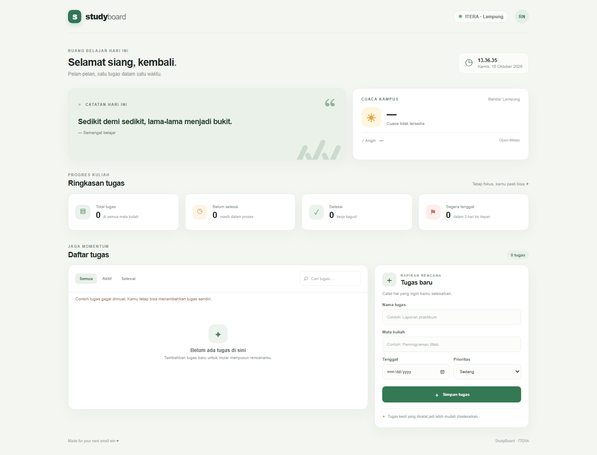
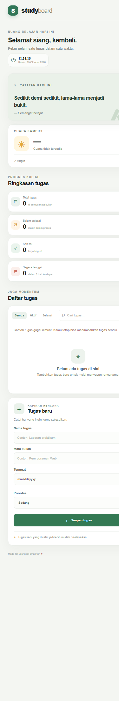

# StudyBoard — Personal Dashboard Mahasiswa

**Nama:** Raditya Alrasyid Nugroho · **NIM:** 123140125 · **Kelas:** RB

## Deskripsi

StudyBoard adalah dashboard belajar harian mahasiswa ITERA yang menyatukan daftar tugas, ringkasan progres, jam real-time, cuaca Bandar Lampung, dan kutipan motivasi. Data tugas tersimpan di `localStorage`, jadi tetap tersedia setelah halaman dimuat ulang.

## Fitur

- Tambah, edit, hapus (dengan konfirmasi), dan tandai tugas selesai.
- Simpan dan muat otomatis melalui `localStorage`.
- Filter Semua / Aktif / Selesai dan pencarian judul, mata kuliah, atau prioritas.
- Ringkasan jumlah tugas, tugas aktif, tugas selesai, dan tenggat 3 hari ke depan.
- Tanda tugas terlambat, kategori prioritas, dan validasi nama tugas.
- Tugas contoh dari JSONPlaceholder saat penyimpanan lokal kosong.
- Cuaca kampus dari Open-Meteo, kutipan dari DummyJSON, serta jam dan tanggal lokal.
- Tampilan responsif untuk desktop dan ponsel.

## Screenshot

Tangkapan layar desktop dan ponsel tersedia di folder `screenshots/`:

> Tangkapan layar dibuat saat API tidak dapat dijangkau; aplikasi menampilkan pesan fallback. Saat dibuka dengan koneksi internet, cuaca, kutipan, dan tugas contoh akan dimuat dari API.

## Fitur ES6+ yang Diimplementasikan

| No | Fitur | Contoh | Lokasi |
|---:|---|---|---|
| 1 | `const` dan `let` | Nilai tetap; sapaan berubah sesuai jam | `app.js` baris 1–338, khususnya 295–300 |
| 2 | Arrow function | Pemetaan, filter, event listener, interval | `app.js` baris 59, 82, 139, 144, 159–160, 163, 173, 175, 187, 202, 224, 228, 243, 249, 251, 256, 291 |
| 3 | Template literals | Kartu tugas, cuaca, kutipan, dan pesan | `app.js` baris 16, 75, 86, 107, 109, 125, 161, 177, 185, 188, 191–198, 236, 300 |
| 4 | Async/await | Fetch tugas, cuaca, dan kutipan dengan `try/catch` | `app.js` baris 71–130 |
| 5 | Class | `class TaskItem`, `class DashboardApp` | `app.js` baris 2, 25 |
| 6 | Destructuring | Parameter constructor dan data API | `app.js` baris 3, 82, 106, 123 |
| 7 | Spread operator | Salin tugas saat toggle dan update | `app.js` baris 20, 139 |
| 8 | Default parameter | Nilai awal model tugas | `app.js` baris 3 |
| 9 | Array methods | `map`, `filter`, `find`, `sort` | `app.js` baris 59, 82, 139, 144, 149, 159, 163, 173, 175, 187 |

> Nomor baris mengikuti versi berkas saat ini. Jika kode diubah, sesuaikan kembali nomor baris pada tabel.

## Cara Menjalankan

1. Buka folder `RadityaAlrasyidNugroho_123140125_Pertemuan2` di VS Code.
2. Jalankan `index.html` dengan Live Server, atau buka langsung di browser.
3. Koneksi internet diperlukan untuk data contoh dan informasi dari API. Fitur CRUD tetap berjalan ketika API tidak tersedia.

## Penyimpanan Data

Kunci `studyboard-tasks` di `localStorage` menyimpan daftar tugas. Untuk memuat ulang lima data contoh, hapus kunci tersebut melalui DevTools → Application → Local Storage, lalu refresh halaman.
