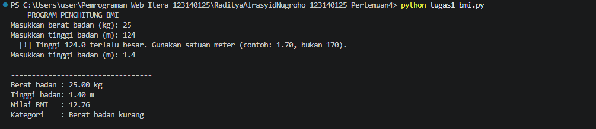
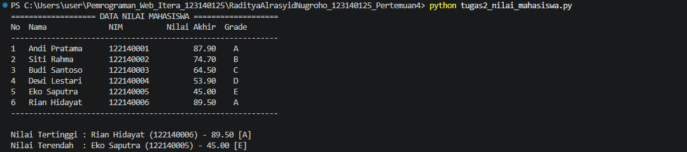
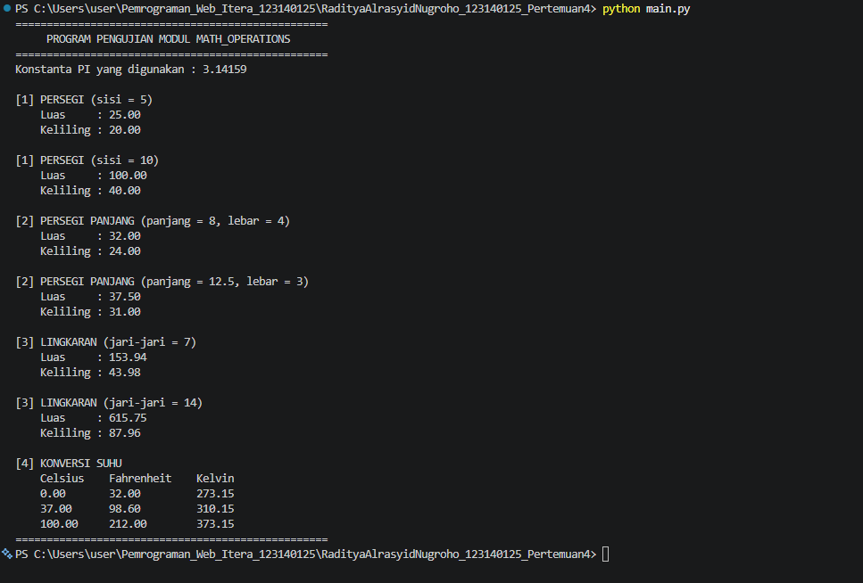

# Tugas Praktikum PAW — Pertemuan 4: Python Dasar

## Identitas Mahasiswa

| Item  | Keterangan                               |
|-------|------------------------------------------|
| Nama  | Raditya Alrasyid Nugroho                 |
| NIM   | 123140125                                |
| Kelas | Pengembangan Aplikasi Web RB             |

## Struktur Folder

```
RadityaAlrasyidNugroho_123140125_Pertemuan4/
├── .gitignore
├── README.md
├── tugas1_bmi.py
├── tugas2_nilai_mahasiswa.py
├── math_operations.py
├── main.py
└── screenshots/
    ├── soal1_bmi.png
    ├── soal2_nilai.png
    └── soal3_main.png
```

Semua program hanya memakai standard library Python, jadi tidak perlu `pip install`.

## Deskripsi Program

### Soal 1 — `tugas1_bmi.py` (Penghitung BMI)

Alur: **input → validasi → hitung → kategori → output**

1. Pengguna memasukkan berat badan (kg) dan tinggi badan (m) lewat `input()`, lalu nilainya dikonversi dengan `float()`.
2. Input divalidasi. Program meminta ulang jika input bukan angka, bernilai ≤ 0, atau tinggi > 3 (kemungkinan diisi dalam cm).
3. BMI dihitung dengan rumus `BMI = berat / (tinggi * tinggi)`.
4. Kategori ditentukan dengan `if-elif-else`:

   | Kondisi            | Kategori             |
   |--------------------|----------------------|
   | BMI < 18.5         | Berat badan kurang   |
   | 18.5 ≤ BMI < 25    | Berat badan normal   |
   | 25 ≤ BMI < 30      | Berat badan berlebih |
   | BMI ≥ 30           | Obesitas             |

5. Hasil dicetak dengan f-string, termasuk BMI dengan 2 angka desimal dan kategorinya.

Fungsi:
- `hitung_bmi(berat, tinggi) -> float`: menghitung BMI.
- `tentukan_kategori_bmi(bmi) -> str`: menentukan kategori dengan if-elif-else.
- `minta_angka_positif(pesan) -> float`: meminta input angka > 0 dan menangani `ValueError`.
- `main()`: titik masuk program.

### Soal 2 — `tugas2_nilai_mahasiswa.py` (Pengelolaan Nilai Mahasiswa)

- **Struktur data:** list `data_mahasiswa` berisi 6 dictionary dengan kunci `nama`, `nim`, `nilai_uts`, `nilai_uas`, dan `nilai_tugas`.
- **Rumus nilai akhir:** `(0.30 * UTS) + (0.40 * UAS) + (0.30 * Tugas)`
- **Grade:** A (≥ 80), B (70–<80), C (60–<70), D (50–<60), E (< 50)
- **Tabel:** data ditampilkan dengan kolom No, Nama, NIM, Nilai Akhir, dan Grade, dirapikan dengan perataan f-string (`:<`, `:>`, `:^`).
- **Tertinggi & terendah:** dicari dengan `max()`/`min()` dan `key=lambda m: m["nilai_akhir"]`, lalu dikembalikan sebagai tuple.

Fungsi:
- `hitung_nilai_akhir(uts, uas, tugas) -> float`
- `tentukan_grade(nilai_akhir) -> str`
- `proses_data_mahasiswa(daftar) -> list`: membuat list baru yang memuat `nilai_akhir` dan `grade`.
- `tampilkan_tabel(daftar) -> None`
- `cari_tertinggi_terendah(daftar) -> tuple`: mengembalikan `(tertinggi, terendah)`.
- `format_ringkas(mhs) -> str`: mengubah data satu mahasiswa menjadi satu baris teks.
- `main()`

### Soal 3a — `math_operations.py` (Modul)

Konstanta: `PI = 3.14159`

| Fungsi                                   | Rumus                    |
|------------------------------------------|--------------------------|
| `luas_persegi(sisi)`                     | `sisi * sisi`            |
| `keliling_persegi(sisi)`                 | `4 * sisi`               |
| `luas_persegi_panjang(panjang, lebar)`   | `panjang * lebar`        |
| `keliling_persegi_panjang(panjang, lebar)` | `2 * (panjang + lebar)` |
| `luas_lingkaran(jari_jari)`              | `PI * jari_jari ** 2`    |
| `keliling_lingkaran(jari_jari)`          | `2 * PI * jari_jari`     |
| `celsius_ke_fahrenheit(celsius)`         | `celsius * 9 / 5 + 32`   |
| `celsius_ke_kelvin(celsius)`             | `celsius + 273.15`       |

Fungsi geometri memunculkan `ValueError` jika ukuran bernilai negatif. Uji coba internal modul dibungkus `if __name__ == "__main__":`, jadi tidak ikut tercetak saat modul di-import.

### Soal 3b — `main.py` (Program Utama)

Cara impor yang dipakai:

```python
import math_operations                  # cara 1: persegi & persegi panjang
import math_operations as mo            # cara 2: lingkaran
from math_operations import (           # cara 3: PI & konversi suhu
    PI,
    celsius_ke_fahrenheit,
    celsius_ke_kelvin,
)
```

Program memanggil **ke-8 fungsi** modul dengan beberapa nilai uji: persegi (sisi 5 dan 10), persegi panjang (8×4 dan 12.5×3), lingkaran (r = 7 dan 14), serta konversi suhu 0 °C, 37 °C, dan 100 °C. Semua hasil ditampilkan per bagian dengan 2 angka desimal.

## Cara Menjalankan

Buka terminal di VS Code, lalu jalankan:

```bash
cd RadityaAlrasyidNugroho_123140125_Pertemuan4
python tugas1_bmi.py
python tugas2_nilai_mahasiswa.py
python main.py
# jika perintah python tidak dikenali: gunakan python3
```

Opsional, untuk memakai virtual environment:

```bash
python -m venv venv
.\venv\Scripts\activate      # Windows
source venv/bin/activate     # macOS/Linux
```

## Screenshot Hasil Eksekusi

### Soal 1 — Penghitung BMI


### Soal 2 — Data Nilai Mahasiswa


### Soal 3 — Program Pengujian Modul

